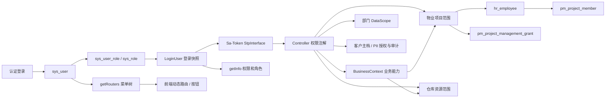

# TASK-AUTH-014 全系统权限体系审计报告

审计日期：2026-10-10（Asia/Shanghai）  
范围：后端、前端、运行日志与本机 WSL `archlinux` / Docker `jdpm-mysql` / MySQL 8.0.46 / `zbm-data`。  
边界：本次没有修改权限代码、SQL、角色授权或业务数据，也没有执行 migration。

## 1. 结论摘要

1. 当前数据库中的 `admin` 是真实 SuperAdmin：`user_id=1761100000000000001`，正好等于代码常量 `SUPER_ADMIN_USER_ID`；用户、角色均启用且未删除，关联角色为 `superadmin`。
2. SuperAdmin 不是按用户名识别，也不是仅按 `role_key=superadmin` 识别。核心判断只比较固定用户 ID。当前 `admin` 恰好满足该条件。
3. 当前代码和数据库不能产生“admin 后端没有权限/菜单”的结果：其登录权限为 `*:*:*`、角色为 `superadmin`，`getRouters` 直接查询全部 66 个有效目录/菜单节点，不依赖 `sys_role_menu`。
4. 运行日志表明 admin 在 2026-10-10 11:18:54 重新登录后，`getInfo`、`getRouters`、`/property/workspace/projects` 以及客户关系业务接口均成功。因此当前运行态属于“菜单、接口均正常”，原现象未复现，最可能是旧前端资产、旧进程或旧浏览器会话造成的版本错配，而不是 V2.0.34 删除了 admin 权限。
5. `test_cashier` 的旧错误已经被日志精确定位：08:58:54 的旧前端确实请求 `/property/project/business-options`，后端以缺少 `property:project:list` 拒绝；11:21:55 同一账号重新登录后请求已变为 `/property/workspace/projects` 且成功。当前源码及 `dist` 均不再调用旧接口，旧 API 仅保留兼容定义。
6. V2.0.34 的七角色权限集合与目标矩阵完全一致：6/38/6/28/20/72/48。数据库菜单关联计数比权限数多 1～3 条，是合法祖先目录节点，不是额外按钮权限。
7. 发现一项独立高危问题：请求耗时日志将 SSE 查询参数中的完整 Authorization token 写入日志。应立即作为独立最小任务修复，并按泄露凭据处理已有日志。
8. 数据库没有 `flyway_schema_history` 表；当前所谓 V2.0.33.1/V2.0.34/V2.0.35 状态来自手工执行记录而非 Flyway 可验证历史。这是部署治理风险，但不是本次 admin 故障根因。

## 2. 实际权限架构

业务接口最终许可是多个维度的交集，而非单一“角色权限”：

`登录有效 ∩ 功能权限 ∩ 业务上下文能力 ∩ 项目/部门/仓库范围 ∩ 资源真实归属 ∩ 业务状态`

## 3. 权限机制清单

| 机制 | 核心实现 | 数据来源 | 影响 | SuperAdmin 行为 |
|---|---|---|---|---|
| 登录认证 | `SysLoginService`、`LoginHelper`、Sa-Token | `sys_user`、客户端配置、Token Session | 登录态 | 固定 user ID 仍须正常登录 |
| 用户角色 | `SysRoleMapper`、`SysPermissionServiceImpl` | `sys_user_role`、`sys_role` | 角色集合、数据权限角色 | 返回 `superadmin` |
| 菜单/按钮权限 | `SysPermissionServiceImpl#getMenuPermission`、`SaPermissionImpl` | `sys_role_menu`、`sys_menu`；登录时复制到 `LoginUser` | API 注解、前端按钮 | 返回 `*:*:*` |
| 动态菜单 | `SysMenuController#getRouters`、`SysMenuServiceImpl` | `sys_menu`，普通用户另经角色关联 | 前端路由/侧栏 | 直接取全部正常 M/C 菜单 |
| Controller API | `@SaCheckPermission` / `@SaCheckRole` | 当前 Sa-Token 权限/角色 | 功能授权 | 通配权限/超级角色通过 |
| 部门数据范围 | `PlusDataPermissionHandler`、`@DataPermission` | 登录用户部门、角色 `data_scope` | SQL 行范围 | 明确跳过 |
| 员工组织身份 | `IEmployeeService` | `hr_employee`、`sys_dept`、岗位关系 | 项目成员链、公司仓范围 | 部分业务被上层 bypass；admin 当前无员工记录 |
| 物业业务项目范围 | `PropertyProjectScopeServiceImpl`、contributors | `sys_user → hr_employee → pm_project_member` | 项目业务数据 | `ALL` |
| 项目管理授权 | `resolveManagementScope` | `pm_project_management_grant`（USER/ROLE） | 项目管理动作 | `ALL` |
| 客户主档/PII | `CustomerAccessPolicyImpl` | RBAC、`pm_customer_management_grant`、PII 权限与审计表 | 企业客户与敏感字段 | 显式 bypass，同时仍记录审计路径 |
| 仓库范围 | `WarehouseAccessService` | 部门数据范围、仓库公司/项目属性、项目成员范围 | 公司仓、项目仓、物料公司 | 明确 bypass |
| BusinessContext | `BusinessContextPolicy`、`BusinessContextAccessServiceImpl` | Sa-Token 当前权限 | Options 的业务能力 | 由 `*:*:*` 通配通过 |
| 工作项目 | `PropertyWorkspaceController`、workspace policy/store | 既有业务权限 + 各业务域项目范围 | 登录后 UI 默认筛选 | 返回全部有效项目 |
| 前端路由/按钮 | `permission.ts`、permission/user store、`v-hasPermi` | `getInfo` + `getRouters` | 可见性和交互 | wildcard 与全部路由 |
| 权限刷新 | 登录时构造 `LoginUser`；角色服务变更时注销相关会话 | Token Session | 会话内权限快照 | 直接 SQL 不会自动刷新现有会话 |

## 4. 四条调用链

### A. Admin

`登录成功 → user_id 固定值命中 SuperAdmin → LoginUser(menu=*:*:*, role=superadmin) → getRouters 查询全部正常 M/C → 前端生成动态路由 → API 通配鉴权通过 → 数据范围服务分别执行 SuperAdmin bypass`

当前 admin 没有 `hr_employee` 记录，但项目、管理和仓库的 SuperAdmin 分支在进入普通员工链之前返回全范围，因此不导致 admin 数据为空。

### B. 物业客服

`登录 → customerRelation 六项 RBAC → CUSTOMER_RELATION_* BusinessContext → hr_employee → ACTIVE pm_project_member → 项目内楼栋/单元/房屋/客户关系 → 资源归属与状态校验`

功能权限决定“能否办理”，项目成员决定“能办理哪些项目”，迁入/迁出状态机仍是第三层业务校验。

### C. 收费员

`登录 → receivable/payment 六项 RBAC → RECEIVABLE_QUERY 或 PAYMENT_CREATE → FINANCE 项目范围 → 应收/房屋/客户真实项目归属 → 收款金额与核销规则`

当前 FINANCE 范围的 contributor 与普通项目成员相同，尚不存在独立财务项目授权表。`test_cashier` 通过 ACTIVE 员工和项目成员关系获得单项目范围。

### D. 仓库管理员

`登录 → warehouse 单据/库存 RBAC → 对应 BusinessContext → WarehouseAccessService → COMPANY 仓走部门数据范围 / PROJECT 仓走项目成员范围 → 仓库、库位、物料公司、库存维度及单据状态校验`

仓库管理员只有制单与库存读取权限；confirm/complete 不在其 20 项集合中。

## 5. Admin 异常取证

### 已证实

- `admin` 用户启用、未删除，用户 ID 与 `SUPER_ADMIN_USER_ID` 完全相同。
- `admin` 关联启用的 `superadmin` 角色；SuperAdmin 不需要任何 `sys_role_menu` 记录，数据库中该角色关联数确为 0。
- 当前有 66 个启用 M/C 菜单、62 个可见 M/C 菜单、0 个缺失父节点的启用菜单。
- `SysMenuServiceImpl#selectMenuTreeByUserId` 对该用户调用 `selectMenuTreeAll()`。
- 2026-10-10 11:18:54 真实运行日志显示 admin 的 `getInfo`、`getRouters`、workspace 及后续业务请求全部成功。
- 日志中 admin 能继续调用客户关系列表及上下文接口，排除“后端权限为空”和“getRouters 空”两种情形。

### 不能从现有证据证明

- 日志没有响应体，无法还原当时浏览器侧侧栏 DOM 是否曾短暂为空。
- 没有保留出现问题时的浏览器 Network/Console 快照，无法在 A/B 两类中进一步复原旧时刻 UI 行为。

### 根因判断

当前最符合证据的是运行版本/会话不一致，而非数据库授权损坏：上午旧运行态仍请求旧 `business-options`；11 点后的构建改为 workspace，admin 和 cashier 均正常。需要避免把历史日志错误当成当前错误，也需要在每次前后端切换后清理旧进程、重新构建并重新登录。

## 6. test_cashier 错误根因

| 时间 | 实际请求 | 结果 | 判定 |
|---|---|---|---|
| 08:58:54 | `/property/project/business-options` | 403，缺 `property:project:list` | 旧前端调用链，真实回归 |
| 11:21:55 | `/property/workspace/projects` | 成功 | AUTH-013 当前实现生效 |

当前源码的全局初始化链为：

`router guard → getInfo → getRouters → currentProject.initialize → 权限策略判断 → /property/workspace/projects`

`businessProjectOptions()` 仍作为兼容 API 定义存在，但生产源码无调用者；当前 `dist` 仅含 `workspace/projects`。因此该问题已在当前运行态消失。若浏览器仍显示旧错误，应检查它加载的资源 hash/服务端静态目录/代理目标，而不是给 cashier 增加 `property:project:list`。

## 7. 数据库与近期变更影响

- 七角色实际权限数：客服 6、运营 38、收费员 6、财务主管 28、仓管 20、仓库主管 72、项目经理 48，与 V2.0.34 完全一致。
- 七角色 `sys_role_menu` 数分别为 7、41、7、29、22、75、52；多出的记录均为菜单祖先。
- 全库 `sys_role_menu(role_id,menu_id)` 无重复。
- ChargeBinding 为收费管理下独立 C 菜单，路径 `binding`，组件 `property/charge/binding/index`。
- V2.0.33.1/V2.0.35 改菜单定义，不改 admin 和角色关联；V2.0.34 精确限制为七个 role_key，不会命中 superadmin。
- AUTH-013 已实施于源码和当前构建；上午日志来自旧实现，11 点后的日志来自新实现。
- 数据库不存在 Flyway 历史表，仓库 README 也将这些记录描述为手工执行。部署端无法靠 Flyway 自动证明顺序和幂等执行状态。

## 8. 当前冲突与风险（按严重度）

| 严重度 | 问题 | 影响 | 建议 |
|---|---|---|---|
| 严重 | 完整 Authorization token 被写入请求参数日志 | 获得日志即可冒用有效会话 | 参数日志统一屏蔽 Authorization/token；处置既有日志和会话 |
| 高 | 直接 SQL 角色变更不会更新已有 LoginUser 权限快照 | 菜单与 API 权限可在重新登录前保持旧值 | migration 后强制相关用户重新登录，并增加版本/失效机制测试 |
| 高 | migration 无 Flyway 历史表，执行状态只靠文档 | 环境漂移、漏执行、乱序无法自动发现 | 明确采用 Flyway 或受控手工 migration ledger，不能两者混称 |
| 中 | 运行中曾并存旧/新前端与多个后端启动形态（classes/jar、8080/18080） | 同一账号出现互相矛盾的调用链 | 建立单一启动入口和构建版本指纹接口/页面展示 |
| 中 | `sys_menu.perms` 有 4 组重复值 | 审计与角色菜单计数容易误判，授权一项可对应多个节点 | 逐组确认隐藏路由/按钮语义并纳入允许重复基线 |
| 中 | 入库菜单记录为 `M`，却配置页面组件和 list 权限 | 动态路由构建可能把它当目录而非业务页 | 独立检查菜单类型及实际路由可达性，勿在本任务直接改库 |
| 低 | workspace Controller 注解与 service policy 双层维护同一权限列表 | 后续新增业务权限时可能一处遗漏 | 用契约测试保证两份集合一致，后续再考虑单源化 |
| 低 | 工作项目把多个业务域范围取并集 | UI 选择可能对某页合法、对另一页为空 | 页面后端继续执行域内范围校验；前端不要把选择值当授权 |

数据库中 4 组重复权限为 `system:ossConfig:list`、`system:role:edit`、`system:user:edit`、`tool:gen:edit`，每组 2 条；它们属于既有系统菜单/隐藏路由，不是近期物业迁移产生。

## 9. 自动化校验结果

- `BusinessContextAccessServiceTest`：12/12 通过。
- `PermissionContractAuditTest`：6/6 通过。
- `PropertyBusinessRolePermissionTest`：6/6 通过。
- Maven Reactor：38 个模块构建成功。
- 当前契约测试通过说明注解/基线未漂移，但它不能替代浏览器响应体和 UI 渲染验证。

## 10. 最小修复方案与后续 TASK

### TASK-AUTH-014A：请求日志凭据脱敏（最高优先级）

- 修改位置：`PlusWebInvokeTimeInterceptor` 及 SSE token 传递位置。
- SQL：否。
- 测试：Authorization、token、password、client secret 不得出现在 JSON、query、header 日志。
- 风险：低；需要确认排障所需非敏感参数仍保留。

### TASK-AUTH-014B：运行版本一致性与权限诊断

- 增加只读构建版本信息，并在诊断模式记录 `getInfo` 权限数量、`getRouters` 根节点数量（不记录 token/PII）。
- 清理多启动入口，明确前端 dist hash 与后端 build hash。
- SQL：否。
- 验收：admin 新会话得到 wildcard、superadmin 和 13 个根路由；cashier 只请求 workspace。

### TASK-AUTH-014C：权限会话失效治理

- 审核所有角色/菜单变更入口与手工 migration 后的会话失效策略。
- SQL：通常否；若引入权限版本号则另行评审，本阶段不建议。
- 验收：撤权后旧 token 不可继续使用被撤权限；多角色用户正确刷新。

### TASK-AUTH-014D：菜单契约专项

- 校验 M/C/F 类型、组件文件、父子链、重复权限允许清单，重点覆盖入库菜单。
- SQL：只有确认数据错误后才新增独立增量 SQL。
- 验收：admin 全菜单、七角色各自菜单、隐藏详情路由均可达。

### TASK-AUTH-014E：Migration 状态治理

- 选择并固化 Flyway 或受控手工 ledger；补充只读环境状态检查。
- 不回填伪造的 Flyway 历史，不修改已执行历史脚本。
- 验收：每个环境能可靠回答 33.1/34/35 是否执行、何时执行、校验值为何。

## 11. 本次未完成项

- 未保存问题发生瞬间的浏览器 Network/Console，因此没有把 admin 的历史 UI 空白进一步归类为 B 类前端渲染问题。
- 未使用账号密码重新执行浏览器人工验收；本报告使用现有真实运行日志证明 11:18 admin 和 11:21 cashier 的运行链路。
- 未修改或清理已含敏感 token 的历史日志；这需要用户确认后按 TASK-AUTH-014A 单独处理。

