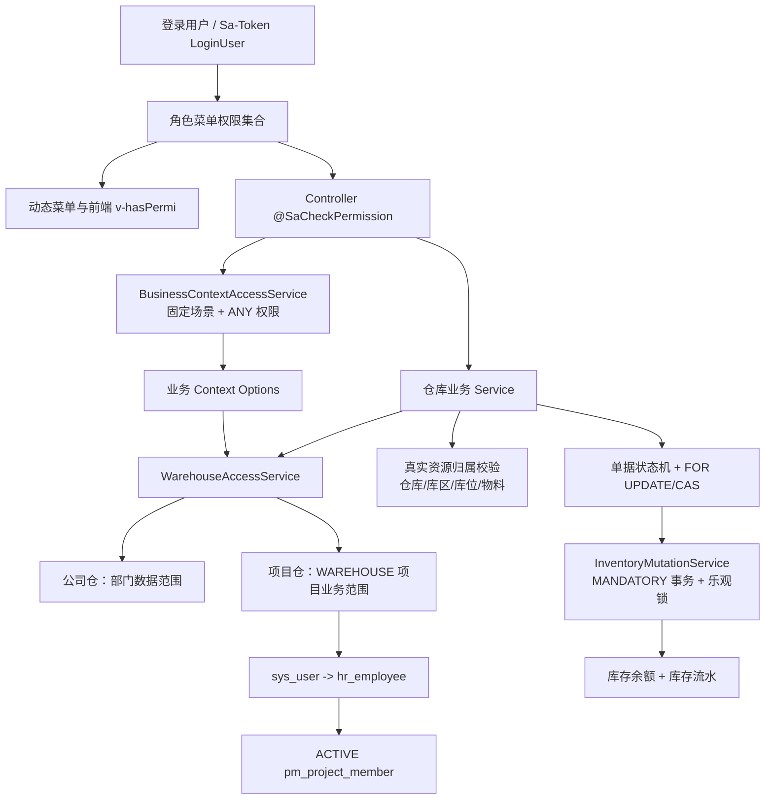

# TASK-AUTH-016-WH 仓库管理模块权限体系专项审计

> 审计日期：2026-10-10 至 2026-10-11  
> 审计范围：`zbm-platform` 后端、`zbm-platform-ui` 前端、本机 WSL `archlinux` 中 `jdpm-mysql / zbm-data` 只读数据  
> 执行边界：本报告仅审计；未修改前后端、数据库、角色授权或历史 Migration，未执行任何仓库业务写操作。

## 1. 结论摘要

仓库模块的后端安全边界总体成立：权限不依赖固定角色名；所有现存写接口都有独立的 `@SaCheckPermission`；单据服务会根据数据库真实仓库、库位、物料归属再次校验资源范围；库存变化只发生在事务中的合法状态转换，使用行锁、CAS、库存版本号和可用量条件防止重复完成与并发超扣。SuperAdmin 只绕过功能/资源范围，不绕过库存不足、单据状态、归属和事务规则。

但“通过角色管理动态授予完整只读权限后页面即可独立使用”目前不完全满足，主要缺陷如下：

1. **高危可用性缺陷**：库存余额、库存流水页面在加载核心列表前，以 `Promise.all` 调用仓库、物料管理 Options。只有库存只读权限的用户会因辅助请求 403 而无法进入页面。
2. **中危权限耦合**：库区、库位、物料分类、物料管理页面分别依赖其他基础资料模块的 `list/options` 权限；四类单据的只读列表筛选也依赖 `warehouse:warehouse:list`，虽然核心列表和详情可以独立查询，但筛选不完整。
3. **中危数据库菜单漂移**：开发库中的“入库管理”菜单为 `menu_type='M'`，而当前基线 SQL 明确定义为页面 `C`。该差异可能使动态路由把页面当目录处理。
4. **低危前端权限反馈问题**：出库、调拨页面的查看、编辑、取消、删除按钮缺少相应 `v-hasPermi`；入库查看按钮缺少 `query` 控制。后端仍会拒绝越权，不构成直接安全绕过，但动态授权用户会看到不可用操作并收到模糊错误。
5. **测试缺口**：现有 117 项仓库单测和权限契约均通过，但缺少只读角色页面初始化、撤权后旧会话、真实公司仓/项目仓集成、并发双请求和浏览器登录态测试。

本次未发现固定仓管/主管角色名白名单、无注解仓库写接口、通用状态接口触发库存、仅凭前端 `warehouseId/projectId` 扩权、调拨只校验源仓不校验目标仓、重复完成可再次变更库存等问题。

## 2. 当前权限架构



### 2.1 各层职责

| 层 | 核心实现 | 职责 | SuperAdmin 行为 |
| --- | --- | --- | --- |
| 登录与功能权限 | Sa-Token、`SysPermissionServiceImpl`、`@SaCheckPermission` | 从当前登录快照判断接口能力 | 获得通配能力 |
| 菜单与按钮 | `sys_menu`、`sys_role_menu`、动态路由、`v-hasPermi` | 页面入口与交互提示，不是安全边界 | 正常构建全部合法菜单 |
| 业务上下文 | `BusinessContextPolicy`、`BusinessContextAccessServiceImpl` | 控制制单引用数据；默认拒绝未声明场景/类型 | Sa-Token 权限规则允许，但仍进入资源过滤 |
| 公司仓范围 | `WarehouseAccessService` + `DeptService` | 按员工组织/部门数据范围限制 `company_id` | 跳过范围过滤 |
| 项目仓范围 | `ProjectReferenceServiceImpl` → `PropertyProjectScopeServiceImpl` → `ProjectMemberBusinessScopeContributor` | 由有效员工和 ACTIVE、启用的项目成员关系得到项目 ID | 返回 ALL |
| 仓库资源归属 | 各订单服务、Context Option 服务 | 按数据库真实仓库、库区、库位、物料公司归属校验 | 不绕过实体存在、启用状态及父子归属 |
| 状态与库存 | 四类单据服务、`InventoryMutationService` | 状态转换、行锁、CAS、库存版本和流水事务 | 不绕过业务状态或库存约束 |
| MyBatis 通用数据权限 | `PlusDataPermissionHandler` | 处理带 `@DataPermission` 的通用部门数据范围 | 通用层跳过过滤 |

仓库业务的主要安全边界是 `WarehouseAccessService` 的显式过滤与逐资源校验，不应把 `PlusDataPermissionHandler` 当作仓库列表/详情的唯一防线。

## 3. 仓库资源数据范围调用链

### 3.1 公司仓

`WarehouseAccessService.assertAccess` 从数据库加载仓库；`warehouse_type=COMPANY` 时调用部门数据范围检查。列表和导出先通过 `accessibleWarehouseIds/applyScope` 获得可见仓库 ID，再传给 Mapper；详情再按记录中的真实 `warehouse_id` 校验。

结论：无法只修改请求中的 `companyId` 或 `warehouseId` 获取其他公司仓；物料、库存、流水和单据详情最终都回到真实仓库范围校验。需补充真实多级部门数据集成测试，以确认“可见部门 ID 集合作为公司 ID 集合”的组织模型假设长期成立。

### 3.2 项目仓

调用链：

```text
WarehouseAccessService
  -> ProjectReferenceService.resolveWarehouseScope()
  -> PropertyProjectScopeService.resolveBusinessScope(WAREHOUSE, READ)
  -> ProjectMemberBusinessScopeContributor
  -> findActiveEmployeeIdByUserId(userId)
  -> pm_project_member(employee_id, member_status='ACTIVE', status='0')
```

仓库的真实 `project_id` 决定是否可访问，不采信前端单独提交的 `projectId`。员工失效或项目成员关系退出后，后续 scope 解析实时读库，应立即失去资源范围；会话清理不是项目范围安全成立的前提。

### 3.3 调拨双侧范围

调拨创建、更新、查看、确认、完成均分别校验源仓和目标仓；源/目标库位分别校验所属仓库；Phase 1 明确拒绝跨公司调拨。授权源仓不能推出目标仓权限。完成时源仓减库存、目标仓增库存处于同一事务。

### 3.4 导出与批量操作

- 四类单据、库存余额、库存流水导出复用带授权仓库 ID 的查询服务，与列表范围一致。
- 批量删除只允许草稿，并逐条读取单据和校验真实仓库后再删除。
- 当前未发现只按前端 ID 集合直接批量更新、跳过逐条授权的路径。

## 4. 页面与 API 依赖矩阵

“独立可用”表示只授予该页面完整只读权限（通常为 `list + query`）时，列表、详情与必要筛选能否工作。

| 页面 | 核心只读权限 | 初始化/筛选依赖 | Options 当前权限 | 独立可用 | 风险 |
| --- | --- | --- | --- | --- | --- |
| 仓库管理 | `warehouse:warehouse:list/query` | company-options、project-options | `warehouse:warehouse:list` | 是 | 低；自身权限闭环 |
| 库区管理 | `warehouse:zone:list/query` | warehouse/options | `warehouse:warehouse:list` | 否 | 中；跨模块 list 耦合 |
| 库位管理 | `warehouse:location:list/query` | warehouse/options、zone/options | `warehouse:warehouse:list`、`warehouse:zone:list` | 否 | 中；两层耦合 |
| 物料分类 | `warehouse:materialCategory:list/query` | material/company-options | `warehouse:material:list` | 否 | 中；分类查询依赖物料管理 |
| 计量单位 | `warehouse:unit:list/query` | 无跨模块 Options | 无 | 是 | 低 |
| 物料管理 | `warehouse:material:list/query` | company-options、unit/options、category/options | material:list、unit:list、materialCategory:list | 否 | 中；单位/分类管理权限耦合 |
| 库存余额 | `warehouse:inventory:list/query` | material/company-options、warehouse/options；级联 category/zone/location options | material:list、warehouse:list、materialCategory:list、zone:list、location:list | **否** | **高**；`Promise.all` 失败会阻断核心列表 |
| 库存流水 | `warehouse:inventoryTransaction:list/query` | material/company-options、warehouse/options；级联 zone/location options | material:list、warehouse:list、zone:list、location:list | **否** | **高**；辅助 Options 失败阻断核心列表 |
| 入库管理 | `warehouse:inbound:list/query` | 只读筛选用 warehouse/options；详情使用单据快照 | warehouse:list；制单 Context 为 inbound add OR edit | 部分 | 中；列表/详情可用，仓库筛选不自洽 |
| 出库管理 | `warehouse:outbound:list/query` | 同上；制单另需物料、库位、可用库存 Context | warehouse:list；Context 为 outbound add OR edit | 部分 | 中；筛选不自洽，部分按钮未隐藏 |
| 调拨管理 | `warehouse:transfer:list/query` | 源/目标仓筛选；制单双侧 Context | warehouse:list；Context 为 transfer add OR edit | 部分 | 中；筛选不自洽，部分按钮未隐藏 |
| 盘点管理 | `warehouse:stocktake:list/query` | 仓库筛选；制单 Context | warehouse:list；Context 为 stocktake add OR edit | 部分 | 中；筛选不自洽 |

### 4.1 单据页面只读与制单能力的区分

- 只读详情已通过 `appendReadonlyOptions(detail)` 使用单据返回的名称快照，不会强制调用 add/edit Context Options，这是正确设计。
- 新增/编辑固定调用各自业务路径下的 Context API，后端固定 BusinessContext，不接受前端权限字符串。
- 目前缺的是只读筛选 Context，而不是放开现有管理 Options。建议新增受 `list/query` 保护的精简只读上下文，不应让查询用户获得 add/edit Context。

## 5. BusinessContext 映射

| Context | 权限语义 | ReferenceType | 资源过滤 |
| --- | --- | --- | --- |
| `INBOUND_MAINTAIN` | `inbound:add OR inbound:edit` | WAREHOUSE、ZONE、LOCATION、MEASUREMENT_UNIT、MATERIAL | 授权仓库；库区/库位真实归属；物料与仓库同公司 |
| `OUTBOUND_MAINTAIN` | `outbound:add OR outbound:edit` | 上述类型 + INVENTORY | 额外按指定仓库/库位/物料查询可用库存 |
| `TRANSFER_MAINTAIN` | `transfer:add OR transfer:edit` | 上述类型 + INVENTORY | 源、目标仓分别校验；库存仅取合法源仓 |
| `STOCKTAKE_MAINTAIN` | `stocktake:add OR stocktake:edit` | 上述类型 + INVENTORY | 仅授权仓库和真实资源归属 |

### 5.1 评价

- 映射不依赖角色名，动态授予实际 add/edit 权限即可获得对应制单引用能力。
- 只有基础资料管理 `list` 权限不能调用单据 Context，符合隔离原则。
- add 与 edit 采用 ANY，适合共用表单候选数据；真实新增/修改接口仍分别校验自身权限。
- Policy 中不存在库存、流水、四类单据只读查询 Context，导致前端退回管理 Options 或无筛选项，是本次只读动态授权不自洽的根因。
- 当前 Context 声明与服务实际引用类型一致，未发现“Policy 未声明但页面制单必需”的仓库引用类型。

## 6. 后端操作与库存安全审计

### 6.1 Controller 权限

实际存在的四类单据动作一致：`list`、`query`、`add`、`edit`、`remove`、`confirm`、`complete`、`cancel`、`export`。每个写动作都有独立权限注解；未发现假设中的“submit”或独立“发出/接收”接口。库存余额和流水 Controller 只有查询、汇总/导出，没有外部库存写接口。

### 6.2 状态和事务

| 业务 | 库存变化时点 | 关键防线 |
| --- | --- | --- |
| 入库 | `CONFIRMED -> COMPLETED` | 单据 `FOR UPDATE`、状态 CAS、库存版本 CAS；增加库存和流水同事务 |
| 出库 | `CONFIRMED -> COMPLETED` | 行锁、状态 CAS；SQL 同时检查版本及 `quantity - locked_quantity >= change` |
| 调拨 | `CONFIRMED -> COMPLETED` | 双仓授权；源/目标余额按 ID 排序加锁；减与增同事务；同公司限制 |
| 盘点 | `CONFIRMED -> COMPLETED` | 单据锁；库存行排序加锁；账面量未变化、锁定量不超实际量、版本 CAS |

`InventoryMutationService` 使用 `Propagation.MANDATORY`，防止脱离上层事务单独修改余额。唯一键竞争和乐观锁失败会抛异常并回滚。重复完成会被单据状态和 CAS 拒绝。`@RepeatSubmit` 是体验层防重，数据库锁/CAS 才是并发安全边界。

### 6.3 SuperAdmin

SuperAdmin 可访问全部合法仓库和 Context，但仍会经过：实体存在/启用状态、库区库位归属、物料公司归属、跨公司调拨禁止、单据状态、库存不足、乐观锁和事务约束。未发现 SuperAdmin 绕过库存业务规则的分支。

## 7. 全部仓库权限码

权限契约当前包含 **107 个仓库端点、72 个唯一权限码**：

| 模块 | 权限码 |
| --- | --- |
| warehouse | `warehouse:warehouse:list/query/add/edit/remove` |
| zone | `warehouse:zone:list/query/add/edit/remove` |
| location | `warehouse:location:list/query/add/edit/remove` |
| materialCategory | `warehouse:materialCategory:list/query/add/edit/remove` |
| unit | `warehouse:unit:list/query/add/edit/remove` |
| material | `warehouse:material:list/query/add/edit/remove` |
| inventory | `warehouse:inventory:list/query/export` |
| inventoryTransaction | `warehouse:inventoryTransaction:list/query/export` |
| inbound | `warehouse:inbound:list/query/add/edit/remove/confirm/complete/cancel/export` |
| outbound | `warehouse:outbound:list/query/add/edit/remove/confirm/complete/cancel/export` |
| transfer | `warehouse:transfer:list/query/add/edit/remove/confirm/complete/cancel/export` |
| stocktake | `warehouse:stocktake:list/query/add/edit/remove/confirm/complete/cancel/export` |

未发现重复权限码、孤立的仓库按钮权限或缺少父节点的仓库菜单记录。基础资料没有 export Controller，因此没有虚构 export 权限。

## 8. 仓库管理员与仓库主管权限差异

开发库只读核对结果：

| 角色 | 仓库权限数 | 实际能力 |
| --- | ---: | --- |
| `property_warehouse_keeper` | 20 | 入库与出库的 list/query/add/edit/remove/cancel/export；库存、流水 list/query/export |
| `property_warehouse_manager` | 72 | 全部仓库基础资料 CRUD；库存/流水；四类单据全部动作，包括 confirm/complete |

仓管没有仓库/库区/库位/物料基础资料管理权限，没有入出库 confirm/complete，也没有调拨/盘点权限；主管拥有全部 72 个仓库权限。当前集合与 V2.0.34 目标矩阵一致，未发现七角色默认矩阵漂移或意外 `system:*`/SuperAdmin 权限。

注意：仓管当前持有入出库 `query`，所以详情能力本身存在；页面筛选耦合不能通过扩大其基础资料权限解决。

## 9. 数据库菜单审计

### 9.1 已通过检查

- 仓库权限 `perms` 唯一。
- `sys_role_menu(role_id, menu_id)` 无重复。
- 仓库菜单父节点均存在，无孤儿节点。
- 仓库根、基础资料、库存目录及业务页面均启用、可见。
- 菜单按钮与当前 Controller 权限集合总体匹配。

### 9.2 已确认漂移

开发库 `warehouse:inbound:list` 对应菜单被标记为 `menu_type='M'`，但 `script/sql/zbm/baseline/03_menu_permission.sql` 将同一菜单定义为 `C`，且记录带有页面组件 `warehouse/inbound/index`。`V2.0.28` 只修正父节点，不修正菜单类型。

影响：动态路由可能把入库页面作为目录而非组件页面处理。需要单独增量 SQL 修复并先做 `getRouters` 回归；本次未执行 SQL。

## 10. 动态授权与撤权适配

### 10.1 支持情况

- Controller、BusinessContext 和资源范围判断均基于权限码与当前用户资源关系，没有仓管/主管角色名判断。
- 动态授予四类单据 add/edit 后，对应 Context Options 可用；授予 confirm/complete 不会自动获得制单或查询权限。
- 角色管理保存菜单后，`SysRoleServiceImpl` 在事务提交后发布 `OnlineUserCleanEvent.byRole(roleId)`，监听器异步清理该角色在线用户，用户重新登录后加载新权限快照。
- 直接改数据库不会触发上述在线会话清理，不应作为动态授权的标准操作方式。

### 10.2 不满足场景

- 普通客服临时获得 `inventory:list/query`：菜单可显示，但库存页面初始化会调用无权的 warehouse/material 等管理 Options，核心列表可能因 `Promise.all` 整体拒绝而不加载。
- 仅获得四类单据 `list/query`：列表和详情后端可用，但仓库筛选没有合法的只读 Options。
- 撤权后旧会话：代码具备踢下线机制，但本次未进行真实浏览器/Token 试验；异步监听失败时功能权限仍取决于旧 LoginUser 快照，需用集成测试明确最大窗口与失败告警。

## 11. 问题清单与证据

| 编号 | 严重度 | 问题 | 证据位置 | 影响 |
| --- | --- | --- | --- | --- |
| WH-01 | 高 | 库存余额页面核心列表被管理 Options 的 `Promise.all` 阻断 | `zbm-platform-ui/src/views/warehouse/inventory/index.vue` 的 `onMounted` | 动态授予库存只读权限仍无法使用页面 |
| WH-02 | 高 | 库存流水页面同样被 management Options 阻断 | `zbm-platform-ui/src/views/warehouse/inventoryTransaction/index.vue` 的 `onMounted` | 流水只读权限不自洽 |
| WH-03 | 中 | 库区/库位/物料分类/物料页面存在跨模块 list 权限耦合 | 对应 Vue `loadOptions`；各 Options Controller | 菜单可见但筛选或初始化 403 |
| WH-04 | 中 | 单据只读筛选缺少业务只读 Context | 四类单据 Vue `onMounted`；`BusinessContextPolicy` 仅有 MAINTAIN | list/query 用户不能完整筛选 |
| WH-05 | 中 | 开发库入库菜单类型为 M，基线为 C | `sys_menu` 只读结果；`03_menu_permission.sql` | 动态路由可能丢失或层级异常 |
| WH-06 | 低 | 出库/调拨编辑、取消、删除、查看按钮缺少 `v-hasPermi`；入库查看缺 query 控制 | 对应 `index.vue` 操作列 | 后端安全，但用户看到不可用按钮和模糊 403 |
| WH-07 | 中（测试风险） | 无浏览器动态授权/撤权、真实范围及并发双请求测试 | 当前 test 清单 | 代码性质正确但运行态保证不足 |
| WH-08 | 低 | 公司候选项依赖部门列表即公司列表的模型假设 | `WarehouseAccessService.selectMaterialCompanyOptions` | 若组织树混有非公司部门，候选项可能不准确；尚未证实越权 |

## 12. 最小修复任务拆分

### AUTH-016-WH-FIX-1：库存只读 Context 与页面解耦

- 范围：为库存余额、库存流水增加固定只读 BusinessContext/专用精简 Options；页面把核心列表与辅助筛选错误分别处理。
- 权限：复用现有 `inventory:list/query`、`inventoryTransaction:list/query`，不新增 DB 权限码。
- SQL/Migration：不需要。
- 测试：只有库存只读权限可加载列表、详情、仓库/物料/库位筛选；管理 list 权限不能替代库存上下文；跨仓拒绝。

### AUTH-016-WH-FIX-2：基础资料页面查询自洽

- 范围：为库区、库位、物料分类、物料页面提供页面域内精简引用查询，或在后端建立固定查询场景；不开放原管理 Options。
- 权限：分别绑定当前页面的 list/query；保持 add/edit/remove 独立。
- SQL/Migration：通常不需要；若无新权限码则菜单不变。
- 测试：动态授予单模块完整只读权限即可独立使用，且不能写入其他基础资料。

### AUTH-016-WH-FIX-3：四类单据只读筛选上下文

- 范围：新增 QUERY 场景或等价固定接口，返回授权仓库的最小 Option；详情继续使用单据快照。
- 权限：各单据 `list OR query`；不得复用 MAINTAIN 的 add/edit。
- SQL/Migration：不需要。
- 测试：list/query 独立使用；查询权限不获得制单、确认或完成能力。

### AUTH-016-WH-FIX-4：前端按钮权限一致性

- 范围：补齐入库、出库、调拨操作列的 `v-hasPermi`，细化 403 提示。
- SQL/Migration：不需要。
- 测试：按单个权限渲染按钮；直接调用仍由后端拒绝。

### AUTH-016-WH-DB-1：修复入库菜单类型漂移

- 范围：新版本增量 Migration，只在目标记录满足已知异常状态时把 `M` 改为 `C`，不重放历史 SQL。
- SQL/Migration：**需要**。
- 前置：保存菜单快照，检查未知人工改动；修复后核对 `getRouters` 和非目标菜单不变。

### AUTH-016-WH-TEST-1：动态授权与库存并发集成测试

- 范围：事务回滚或隔离测试数据；覆盖角色动态授权/撤权、公司仓/项目仓、双侧调拨、两请求并发完成。
- SQL/Migration：不需要生产 Migration；可以使用测试 fixture/seed。
- 浏览器：客服临时库存只读、仓管制单但不能完成、主管完成、撤权后重新登录、SuperAdmin 状态机限制。

## 13. 自动化与运行态验收

| 项目 | 结果 |
| --- | --- |
| 仓库模块编译 | 通过；先安装当前 reactor 依赖后成功 |
| 仓库模块单测 | **117/117 通过**，0 failure，0 error，0 skipped |
| `PermissionContractAuditTest` | **6/6 通过**；生成契约含 269 个总端点，其中仓库 107 个 |
| 仓库唯一权限码 | 72 个 |
| 数据库只读菜单/角色检查 | 已完成；未写库 |
| 真实浏览器动态授权 | 未执行；本任务禁止修改角色权限，无法按测试矩阵临时授权 |
| 真实 Token 撤权 | 未执行；同上 |
| 并发库存写测试 | 未对开发业务数据执行；现有单测覆盖 CAS/版本/不足场景，但不等价于数据库双连接压力测试 |
| 前端生产构建 | 本次未运行；审计未修改前端，且重点是调用链静态核对 |

首次尝试 `-am test` 在公共模块测试阶段长时间无输出，已中止；随后使用 `-am install -DskipTests` 安装当前 reactor 依赖，再独立运行仓库模块测试，结果如上。该中止不计为测试通过或失败。

## 14. 最终判断

- **后端授权与库存安全**：总体合格，未发现角色名硬编码或直接权限绕过；写操作、资源范围、状态机和并发控制边界清晰。
- **动态只读授权页面自洽性**：不合格，库存/流水为高优先级，基础资料与单据筛选为中优先级。
- **公司仓与项目仓隔离**：代码链路成立；需用真实多组织、多项目 fixture 补集成验证。
- **默认角色矩阵**：当前开发库仓管 20、主管 72 个仓库权限，与目标一致，不应通过扩大默认矩阵修复页面问题。
- **SQL 需求**：代码耦合修复不需要权限 Migration；仅入库菜单 `M -> C` 的数据库漂移需要独立增量 Migration。
- **当前可否直接做大范围修复**：否。建议依次执行 FIX-1、FIX-3、FIX-2、FIX-4、DB-1，并为每项保持权限契约与真实范围回归。
